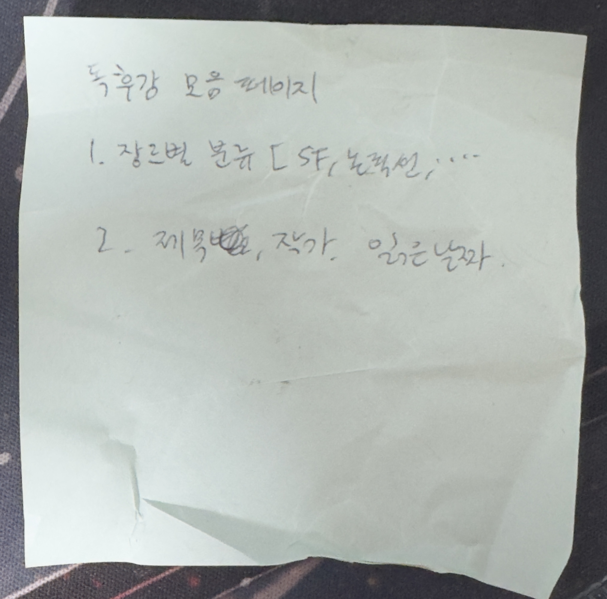

## 배경 및 목표

여자친구가 책을 함께 읽고 독후감을 남기고 싶었으나, 기존 앱들이 마음에 드는 것이 없다고 함.
아래는 그녀의 기획서…

→ 각자 본인 서재만 보이는 멀티유저 독서 기록 사이트를 직접 개발. 책 독후감(/books)과 자유로운 글(/writings)을 같은 도메인 안에서 관리하며, 토스 스타일 디자인 시스템 · 다크모드 · 본문 검색 · 한국어 가변폰트(Pretendard)로 한국어 사용자에 최적화한 UX 제공.

## 역할

전 과정 주도 (1인 풀스택 개발: 도메인 설계 · DB 스키마 · 인증/인가 · UI · 배포 · 운영)

## 주요 업무 및 성과

### ① 독서 기록 도메인 풀스택 구현: 책장 + 글방 + 본문 검색

- 책장: 제목·작가·읽은 날짜·장르·별점·태그·마크다운 본문 CRUD를 Next.js 16 App Router + Drizzle ORM + Turso(libSQL) 스택으로 구현. 위지윅 마크다운 작성을 위한 에디터와, 다크모드까지 적용되는 별도 Viewer로 본문 작성/열람 동선을 분리.
- 글방: 책에 묶이지 않는 자유 마크다운 글을 같은 UI 패턴으로 관리. 두 도메인의 태그 풀을 합집합으로 자동완성해, 사용자가 도메인 경계를 의식하지 않고 태그를 재사용하도록 설계.
- 본문 검색: 제목·작가·본문 LIKE 매칭에 SQL 수준의 가중치 랭킹(제목 → 작가 → 본문)을 부여하고, 매칭 부근 컨텍스트를 추출해 키워드 하이라이트와 함께 노출. 한 번의 쿼리로 어디서 걸렸는지까지 보이는 검색 UX 구현.

### ② "각자만의 공간"을 보장하는 멀티유저 도메인 모델

- 모든 도메인 테이블이 사용자 단위로 격리되도록 스키마를 설계: 두 사용자가 같은 슬러그의 글을 동시에 가져도 데이터가 서로 보이지 않게. URL은 공유되지만 컨텐츠는 비공개라는 가족 단위 사용 패턴에 맞춤.
- 데이터 격리를 DB 쿼리·라우트 가드·middleware 세 레이어에서 동시에 강제. 신규 라우트를 추가할 때 같은 가드 헬퍼만 통과시키면 자동으로 격리되도록, "보안을 매번 새로 짜지 않아도 되는" 추상화를 우선 설계.
- RBAC (admin/member): admin은 가족 구성원 초대 · 비밀번호 reset · 사용자 관리를 전용 콘솔에서 수행. 첫 로그인 강제 변경 플로우를 두어 "임시 비밀번호 공유 → 본인 비밀번호로 교체" 과정을 안전하게 가이드. 마지막 관리자 삭제 방지 같은 운영 가드도 함께.

## 결과

① production 운영 중: Vercel + Turso 자가 호스팅. 모바일/데스크탑 양쪽 대응.

② 토스 톤 디자인 토큰 + Pretendard 가변폰트 + 0-FOUC 다크모드 부트스트랩으로 한국어 UI에 최적화된 독서 기록 환경 구축. 검색·필터·페이지네이션·통계·태그 자동완성 등 1인 서비스에 필요한 기능 라인업을 전부 자체 개발.

## 회고

기존 앱들이 답답했던 이유는 "모든 사용자를 만족시키려" 했기 때문임을 깨달았다. 공개 SNS형 모델을 의도적으로 버리고 비공개 가족 단위로 좁혔더니, 검색·태그·통계 같은 기능 하나하나가 명확한 의도를 갖게 되었다. 좋은 제품은 무엇을 덜어내느냐에서 시작한다는 점을 코드와 디자인 양쪽에서 체득했다.
